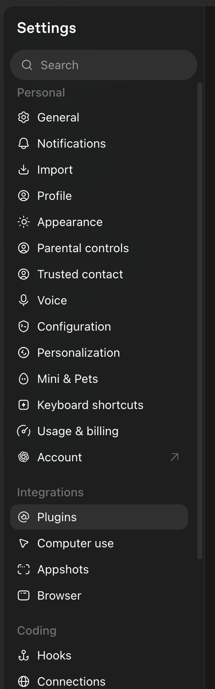
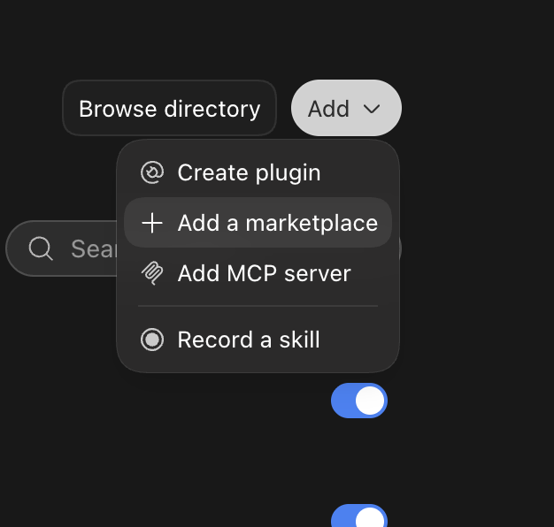
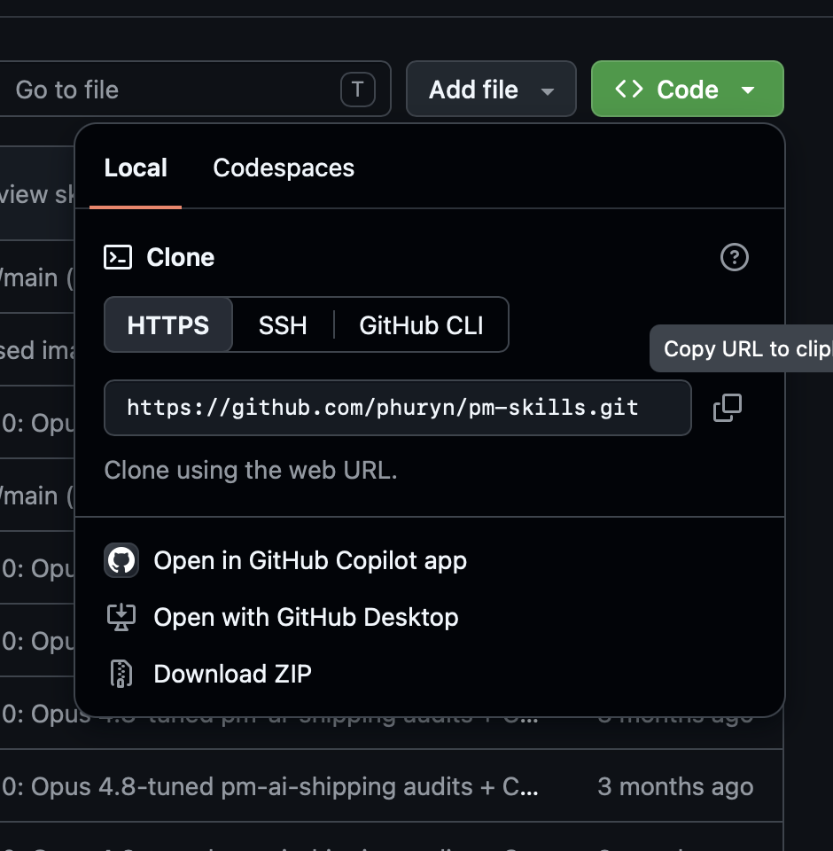
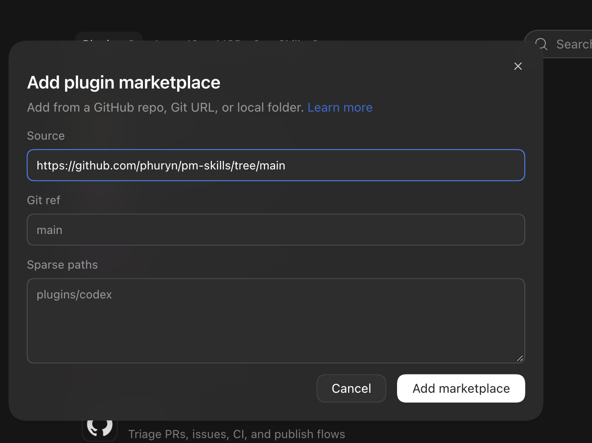
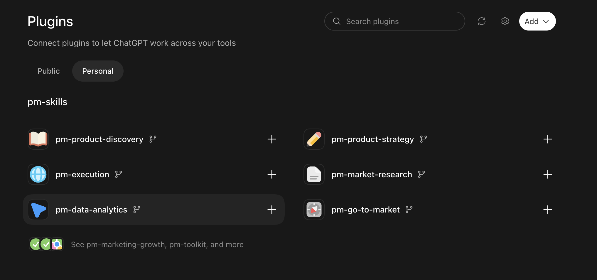
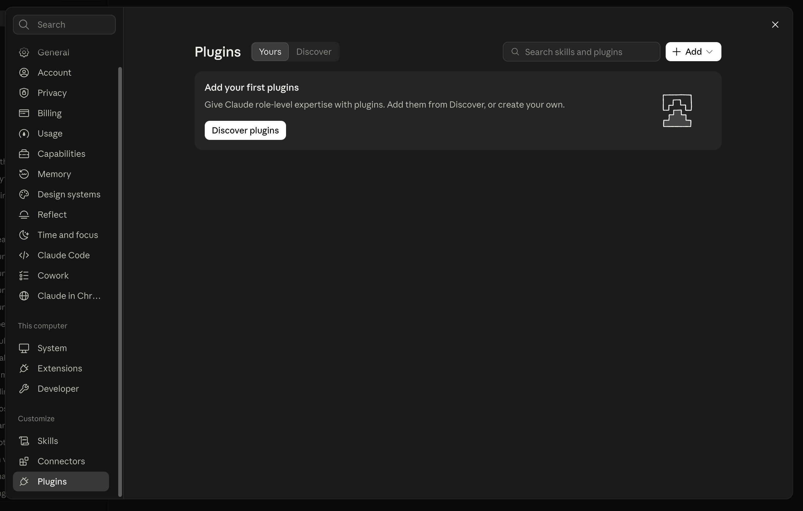
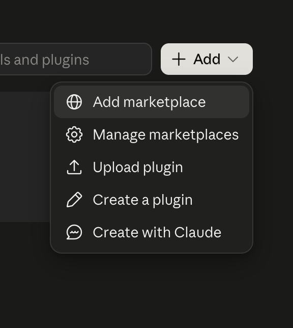
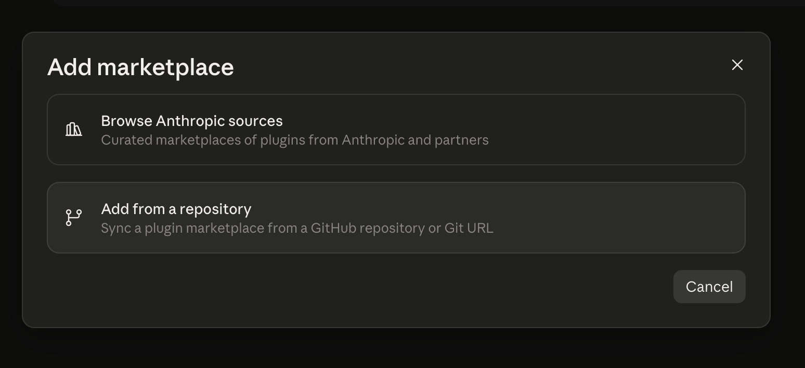
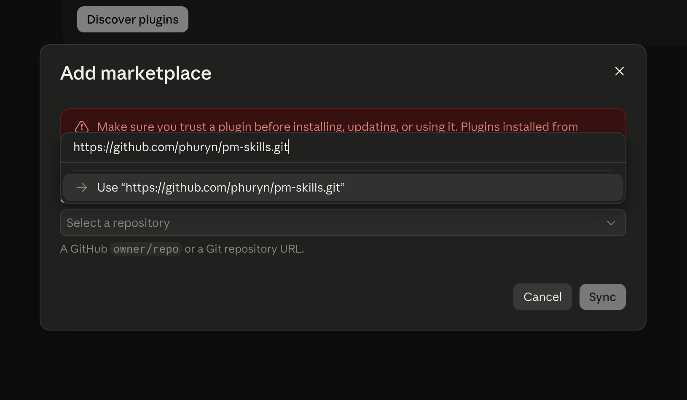
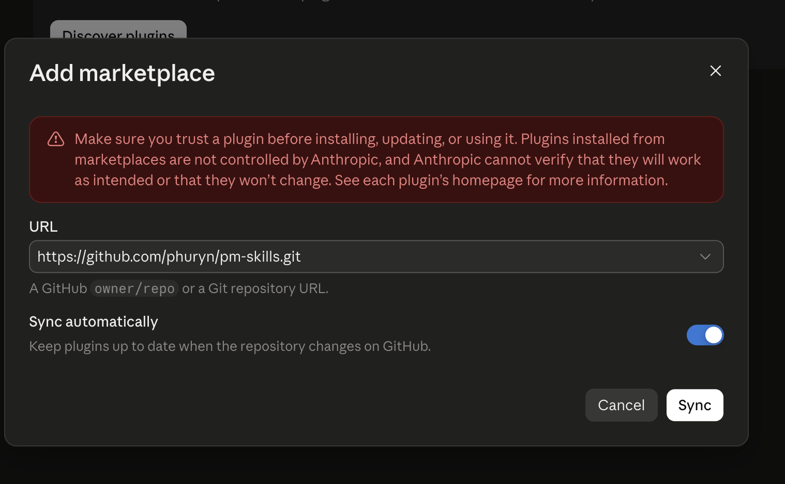

# Příprava na lekci

Před lekcí si nainstaluj dva pluginy: **PM Skills** do AI, se kterou chatuješ, a **Superpowers** do svého agenta. PM Skills budeš potřebovat k produktové analýze aplikace CRM, Superpowers k tomu, abys s agentem aplikaci promyslel(a), naplánoval(a) a postavil(a). Instalace zabere asi 15 minut a v lekci by zdržela, proto ji udělej předem.

## Skills a pluginy

> **Kdy se to hodí:** Chceš, aby ti AI pomohla s prioritizací funkcí nebo aby se tě agent před stavěním nejdřív vyptal, co přesně chceš. Místo abys jim to pokaždé vysvětloval(a), nainstaluješ jim hotový postup, který použijí samy.

*Skill* (dovednost) je návod pro AI na jeden konkrétní úkol, třeba "jak sestavit roadmapu" nebo "jak napsat plán". AI ho načte sama, když se hodí k tomu, o co ji žádáš. *Plugin* sdružuje několik skills do jednoho balíčku, který nainstaluješ najednou. *Marketplace* je zdroj pluginů, nejčastěji repozitář na GitHubu, ze kterého si vybereš, co chceš nainstalovat.

[PM Skills](https://github.com/phuryn/pm-skills) je marketplace s pluginy pro produktové řízení. Pro náš projekt se hodí tři:

- **pm-product-discovery** – hledání a ověřování nápadů a předpokladů, příprava rozhovorů s uživateli.
- **pm-product-strategy** – vize, cílová skupina, odlišení od konkurence.
- **pm-execution** – roadmapa, prioritizace, zadání funkcí (*PRD*, dokument s požadavky na produkt).

[Superpowers](https://github.com/obra/superpowers) je plugin, který agenta učí pracovat disciplinovaně: nejdřív se ptát, pak plánovat a nakonec stavět a všechno ověřit. Agent tím nezchytří, ale přestane spěchat. V lekci použiješ hlavně tyhle skills:

- **brainstorming** – agent se tě vyptá, co a proč chceš postavit, a sepíše návrh aplikace.
- **writing-plans** – ze schváleného návrhu napíše podrobný plán po malých úkolech.
- **executing-plans** a **subagent-driven-development** – podle plánu aplikaci postaví.
- **finishing-a-development-branch** – hotovou práci ti nabídne sloučit, poslat jako pull request, nebo nechat ve větvi.

Přehledný průvodce všemi skills Superpowers najdeš na [superpowers-guide.com](https://superpowers-guide.com/en/welcome).

## Instalace PM Skills

PM Skills nainstaluj do nástroje, se kterým pracuješ. Stačí jeden z nich:

::::alternatives
:::option{label="ChatGPT (aplikace)"}
1. Otevři **Settings** a v části **Integrations** vyber **Plugins**.

   

2. Klikni na **Add → Add a marketplace**.

   

3. Adresu repozitáře PM Skills najdeš na GitHubu pod zeleným tlačítkem **Code** v záložce **HTTPS**: `https://github.com/phuryn/pm-skills.git`.

   

4. Vlož ji do pole **Source**. Pole **Git ref** a **Sparse paths** nech prázdná a potvrď tlačítkem **Add marketplace**. (Na obrázku je v poli Source adresa končící `/tree/main`. Použij adresu z předchozího kroku.)

   

5. Otevři záložku **Personal**. Pod zdrojem **pm-skills** přidej tlačítkem **+** pluginy **pm-product-discovery**, **pm-product-strategy** a **pm-execution**.

   
:::
:::option{label="Codex CLI"}
V terminálu přidej marketplace a pak jednotlivé pluginy:

```bash
codex plugin marketplace add phuryn/pm-skills
codex plugin add pm-product-discovery@pm-skills
codex plugin add pm-product-strategy@pm-skills
codex plugin add pm-execution@pm-skills
```

Pluginy v Codexu nemají vlastní příkazy začínající lomítkem. Napiš prostě, co chceš udělat, a zmiň plugin jménem, třeba "Pomocí pm-execution sestav roadmapu...".
:::
:::option{label="Claude (aplikace)"}
1. Otevři **Settings** a v části **Customize** vyber **Plugins**.

   

2. Vpravo nahoře klikni na **Add → Add marketplace**.

   

3. Vyber **Add from a repository**.

   

4. Vlož adresu `https://github.com/phuryn/pm-skills.git` a potvrď nabídnutou volbu **Use**.

   

5. Zkontroluj adresu v poli **URL** a klikni na **Sync**. Přepínač **Sync automatically** zajistí, že se pluginy aktualizují, když se změní repozitář na GitHubu.

   

6. Ze zdroje **pm-skills** nainstaluj **pm-product-discovery**, **pm-product-strategy** a **pm-execution**.

Pluginy pak najdeš v záložce **Code**: otevři projekt a napiš do pole pro zprávu `/`.
:::
:::option{label="Claude Code CLI"}
V terminálu přidej marketplace a pak jednotlivé pluginy:

```bash
claude plugin marketplace add phuryn/pm-skills
claude plugin install pm-product-discovery@pm-skills
claude plugin install pm-product-strategy@pm-skills
claude plugin install pm-execution@pm-skills
```

Po spuštění `claude` najdeš příkazy pluginů, když napíšeš `/`.
:::
::::

## Instalace Superpowers

Superpowers nainstaluj do agenta, se kterým pracuješ. Stačí jeden z nich:

::::alternatives
:::option{label="Codex (aplikace)"}
1. V aplikaci Codex klikni v postranním panelu na **Plugins**.
2. V sekci **Coding** najdi **Superpowers**.
3. Klikni na **+** vedle názvu a postupuj podle pokynů.
:::
:::option{label="Codex CLI"}
1. V terminálu spusť `codex` a napiš příkaz:

   ```text
   /plugins
   ```

2. Do vyhledávání napiš `superpowers`.
3. Vyber **Install Plugin**.
:::
:::option{label="Claude Code"}
V terminálu spusť `claude` a napiš příkaz:

```text
/plugin install superpowers@claude-plugins-official
```

Plugin se nainstaluje z oficiálního katalogu pluginů pro Claude. Pak Claude Code ukonči (`/exit`) a spusť znovu.
:::
::::

## Ověření

Otevři nový chat (nebo spusť agenta v terminálu znovu) a napiš:

```text
Jaké pluginy z PM Skills a jaké skills ze Superpowers máš k dispozici?
```

AI by měla vyjmenovat aspoň **pm-product-discovery**, **pm-product-strategy** a **pm-execution** a ze Superpowers aspoň **brainstorming**, **writing-plans** a **executing-plans**. Pokud o některých neví, zkontroluj, že se instalace dokončila, a nástroj restartuj. PM Skills a Superpowers nemusí být ve stejném nástroji: PM Skills můžeš mít třeba v ChatGPT a Superpowers v Codexu.
